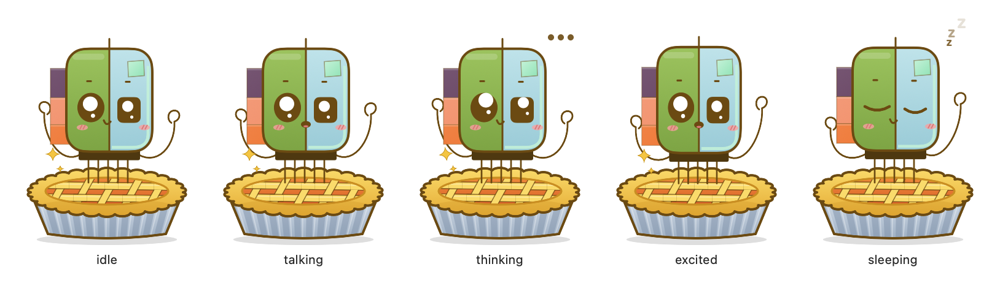
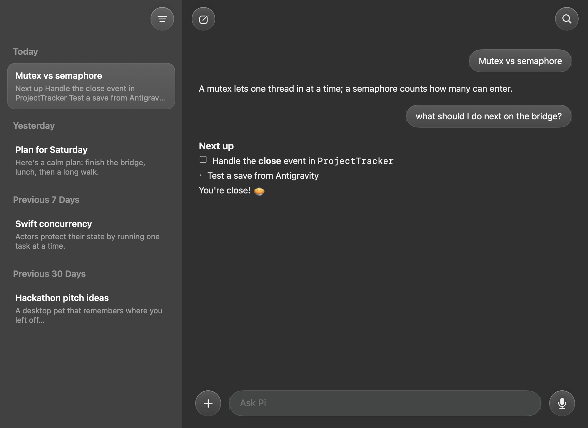

# Pi — desktop pet 🥧

A little Raspberry Pi on a pie that floats on your desktop and helps with your day, powered by your local Ollama model (default `gemma4:e4b`).





## Run

```bash
./build.sh
open build/PiePet.app
```

To start it at login: System Settings → General → Login Items → add `build/PiePet.app`.

## Use

- **Drag** Pi anywhere (position is remembered). **Click** Pi to open the **dashboard**; **right-click** for quick actions.
- **The pill under Pi** has two buttons:
  - 🎙 **Talk**: speak; Pi answers in a bubble and out loud (speech is recognised on this Mac).
  - 🔒 **Lock in**: focus timer (25 min default; right-click for 15/50/90) **plus Do Not Disturb**, then a 5-min break.
    The first time, two Shortcuts windows open: click **Add Shortcut** on both (“Pi Lock In On/Off”).
    You can redo this from the menu bar: 🥧 → Set Up Do Not Disturb…
- **Dashboard**: glossy chat window with your chat history on the left (Today / Yesterday / Previous 7 / 30 days).
  The sidebar button switches between History, Tasks and Notes; ＋ has Plan day, Recap, Clipboard, Resume, Save chat;
  🔍 searches past chats; 🎤 dictates. Chats are kept in `~/Library/Application Support/PiePet/conversations.json`.
- **Tasks & reminders** — “remind me to stretch in 30 minutes”, “add call mom tomorrow at 6pm”, “I finished task 1”, “what's on my list?”. Pi pops a bubble + sound when one is due.
- **Chat** — ask anything; replies stream from your local model.
- **Daily check-ins** — morning plan (after 9:00) and evening recap (after 18:00), once per day. Toggle in the 🥧 menu bar item.
- **Clipboard** — Summarize / Fix writing / Explain / Draft reply on whatever you copied.
- Pi naps after 10 idle minutes. The model is kept loaded for only 3 minutes after each request so your Mac stays cool.

## Notes & project memory (PiNotes)

Everything Pi saves is Markdown in `~/Documents/Hackathon/PiNotes`:

- `notes/`: say “note: …”, “save this chat as a note”, or use 📝 Save chat. Notes tab in the panel lists them all.
- `daily/YYYY-MM-DD.md`: morning plan + evening recap.
- `projects/<name>/CONTEXT.md`: **where you left off** in a project, plus `history/` snapshots.
  Ask “where did I leave off?” or use ＋ → Where did I leave off?

## Antigravity extension (Pi Companion)

`antigravity-extension/` connects Antigravity IDE to Pi over `127.0.0.1:47615` (local only; web pages are refused).
Pi then knows your open project, file and cursor, and writes `CONTEXT.md` from your code + git changes:

- automatically when you **close the project/window** (or if Antigravity quits/crashes, within ~3 min);
- no buttons needed. Click **🥧 Pi** in Antigravity's status bar to read the last saved context.

When you reopen a project, Pi greets you with where you left off. Reinstall after changes:

```bash
antigravity-extension/package.sh --install
```

Menu bar 🥧 → switch model (lists everything installed in Ollama), toggle check-ins, reset position, quit.

Settings (optional): `defaults write local.hackathon.piepet morningHour -int 8` · `recapHour -int 17` · `ollamaURL http://127.0.0.1:11434`.

Tasks are stored in `~/Library/Application Support/PiePet/tasks.json`.
